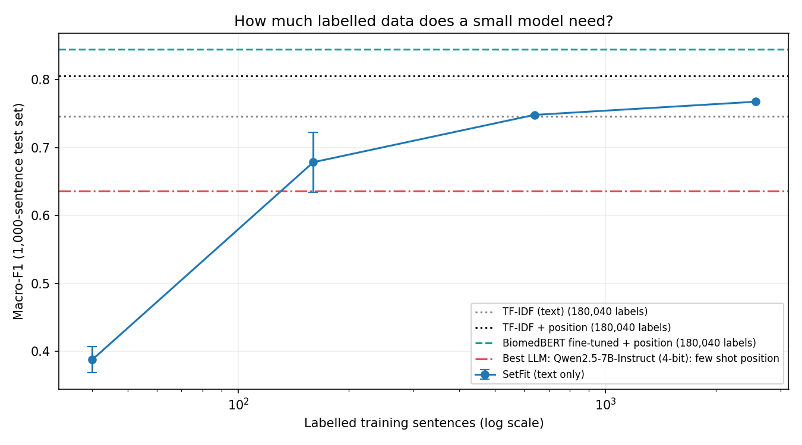
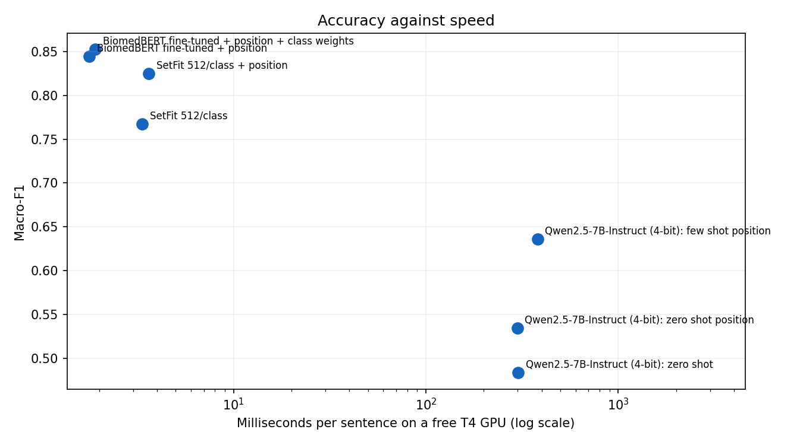

# Small fine-tuned models vs general LLMs for scientific text classification

**Question:** to label the role of each sentence in a medical research abstract, should you fine-tune a small model or prompt a general large language model? And how much labelled data does the small model really need?

**Short answer:** a fine-tuned 110-million-parameter biomedical model (BiomedBERT) was the most accurate model tested (macro-F1 **0.870** on 30,135 test sentences) and about **199 times faster** than a 7-billion-parameter LLM, which scored **0.636**, below even a simple TF-IDF baseline. With only **640 labelled sentences**, a SetFit model matched a TF-IDF model trained on 180,040. And a manual review found that about **half of the best model's "errors" were labelling errors in the benchmark itself**.

## The task and data

**PubMed 20k RCT** ([Dernoncourt & Lee, 2017](https://github.com/Franck-Dernoncourt/pubmed-rct)): 20,000 abstracts of randomised controlled trials, about 240,000 sentences, each labelled **BACKGROUND, OBJECTIVE, METHODS, RESULTS or CONCLUSIONS**.

- Splits: 180,040 training, 30,212 development and 30,135 test sentences.
- Classes are imbalanced (OBJECTIVE is 7.7% of test sentences), so the main metric is **macro-F1**, which weights every class equally.
- Every model is compared on the **same balanced set of 1,000 test sentences** (200 per class, fixed seed), so paired significance tests are possible. Models that run locally are also scored on the full test set.
- The dataset carries no explicit licence and abstracts may be under copyright, so it is **downloaded at runtime and not redistributed** here.

## Models compared

| Family | Model | Labelled training data |
|---|---|---|
| Classic baseline | TF-IDF + logistic regression, with and without sentence position | 180,040 |
| Few-shot fine-tuning | SetFit on a biomedical sentence-transformer (S-PubMedBert-MS-MARCO), 8 to 512 examples per class | 40 to 2,560 |
| Full fine-tuning | BiomedBERT (110M parameters), with and without class weights | 180,040 |
| General LLM | Qwen2.5-7B-Instruct in 4-bit, zero-shot and few-shot, run locally | 0 or 10 examples in the prompt |

"Position" means the sentence's place in its abstract (for example "[3 of 9]"), given to every model that uses it in the same way.

## Results

All scores on the same 1,000 balanced test sentences, with 95% bootstrap confidence intervals. Speeds are measured on a free Google Colab T4 GPU.

| Model | Labelled examples | Macro-F1 (1,000 set) | 95% CI | Full test macro-F1 | OBJECTIVE F1 | Invalid outputs | ms/sentence |
|---|---|---|---|---|---|---|---|
| BiomedBERT fine-tuned + position + class weights | 180,040 | 0.852 | 0.829 to 0.873 | 0.870 | 0.703 | 0 | 1.9 |
| BiomedBERT fine-tuned + position | 180,040 | 0.844 | 0.822 to 0.866 | 0.868 | 0.669 | 0 | 1.8 |
| SetFit 512/class + position | 2,560 | 0.825 | 0.802 to 0.845 | 0.817 | 0.723 | 0 | 3.6 |
| TF-IDF + position | 180,040 | 0.806 | 0.783 to 0.831 | 0.833 | 0.695 | 0 |  |
| SetFit 512/class | 2,560 | 0.767 | 0.740 to 0.791 | 0.764 | 0.672 | 0 | 3.4 |
| TF-IDF (text) | 180,040 | 0.746 | 0.719 to 0.773 | 0.763 | 0.669 | 0 |  |
| Qwen2.5-7B-Instruct (4-bit): few shot position | 10 | 0.636 | 0.604 to 0.664 |  | 0.548 | 26 | 380.0 |
| Qwen2.5-7B-Instruct (4-bit): zero shot position | 0 | 0.535 | 0.501 to 0.565 |  | 0.524 | 77 | 299.0 |
| Qwen2.5-7B-Instruct (4-bit): zero shot | 0 | 0.483 | 0.452 to 0.514 |  | 0.514 | 86 | 302.0 |

### How much labelled data does a small model need?

| Examples per class | Total labelled sentences | SetFit macro-F1 (1,000 set) | Runs |
|---|---|---|---|
| 8 | 40 | 0.388 ± 0.019 | 3 |
| 32 | 160 | 0.678 ± 0.044 | 3 |
| 128 | 640 | 0.748 | 1 |
| 512 | 2,560 | 0.767 | 1 |
| (TF-IDF, text only) | 180,040 | 0.746 | 1 |

### Accuracy against speed

## Key findings

1. **Fine-tuning a small domain model wins.** BiomedBERT fine-tuned + position + class weights reached macro-F1 **0.852** on the balanced set and **0.870** on the full test set, at **1.9 ms per sentence**. It was significantly better than the best baseline (exact McNemar test, p = 8e-6).
2. **Labels are expensive; you need far fewer than you might think.** SetFit with **128 examples per class (640 sentences)** scored **0.748**, the same as TF-IDF trained on **180,040** sentences (0.746). Gains flatten quickly after that.
3. **A general 7B LLM is not competitive here.** Its best setting (few-shot with position) scored **0.636**, below the simplest trained baseline, ran at **380 ms per sentence**, and returned **26** unusable answers out of 1,000 (wrong number of labels or invalid labels). Examples in the prompt helped it far more than position did.
4. **Class weights fix part of the rare-class problem, at no overall cost.** Square-root inverse-frequency weights raised OBJECTIVE F1 from **0.669** to **0.703**. The overall difference was not significant (p = 0.36), so this is a targeted improvement, not a better model overall. Interestingly, SetFit trained on balanced classes still had the best OBJECTIVE F1 (0.723).
5. **The benchmark's labels are a ceiling.** I reviewed 30 randomly sampled sentences where the best unweighted model disagreed with the gold label:

| Judgement | Count |
|---|---|
| Model right, dataset label wrong | 15 |
| Dataset right, model wrong | 9 |
| Both wrong (another label fits better) | 3 |
| Genuinely ambiguous | 3 |

Only about 40% of the model's disagreements were genuine errors. Extrapolated to all disagreements, the model's true accuracy is likely around **91 to 96%**, against a reported 85%. With 30 sentences the uncertainty is wide (the "model right" share has a 95% interval of roughly 33% to 67%), and the review was done by one reviewer who could see both labels, so this is an indicative finding rather than a precise estimate. A blind, two-reviewer relabelling would firm it up.

## Statistical tests

Exact McNemar tests, paired on the same 1,000 sentences, comparing the best model with each of the others:

- vs **BiomedBERT fine-tuned + position**: best right and other wrong on 18 sentences, the reverse on 12; p = 0.36
- vs **SetFit 512/class + position**: best right and other wrong on 79 sentences, the reverse on 48; p = 0.0075
- vs **TF-IDF + position**: best right and other wrong on 78 sentences, the reverse on 31; p = 8e-6
- vs **SetFit 512/class**: best right and other wrong on 133 sentences, the reverse on 44; p = 1e-11
- vs **TF-IDF (text)**: best right and other wrong on 137 sentences, the reverse on 31; p = 4e-17
- vs **Qwen2.5-7B-Instruct (4-bit): few shot position**: best right and other wrong on 269 sentences, the reverse on 43; p = 4e-41
- vs **Qwen2.5-7B-Instruct (4-bit): zero shot position**: best right and other wrong on 377 sentences, the reverse on 42; p = 2e-68
- vs **Qwen2.5-7B-Instruct (4-bit): zero shot**: best right and other wrong on 423 sentences, the reverse on 37; p = 4e-84

## Limitations

- **No frontier LLM result.** A Gemini comparison is included as notebook 05, but it could not be completed on the free API tier because of quota and availability limits. The LLM tested here is a 7B open model in 4-bit, so the result shows the gap for a general model of that size, not for the largest commercial models.
- **LLM prompting was not tuned.** The LLM classified 20 sentences per prompt for efficiency, which is harder than one at a time, and invalid outputs were counted as wrong.
- **Single runs.** Fine-tuning ran once per setting; GPU training is not fully deterministic, and small run-to-run differences (around 0.003 macro-F1) were observed.
- **One dataset, one task.** Conclusions may not transfer to other text types or label schemes.

## Reproduce

Everything runs on free Google Colab. Open the notebooks in order:

| Notebook | What it does | Runtime |
|---|---|---|
| `01_data` | Download data, fix the evaluation set | CPU |
| `02_baseline` | TF-IDF baselines | CPU, about 1 min |
| `03_setfit_learning_curve` | SetFit at 8 to 512 examples per class | T4 GPU, 20 to 35 min |
| `04_biomedbert_finetune` | Full fine-tune | T4 GPU, about 15 min |
| `04b_biomedbert_class_weights` | Full fine-tune with class weights | T4 GPU, about 15 min |
| `05_gemini_optional` | Frontier LLM via API (needs a key) | CPU |
| `06_open_llm_local` | Qwen2.5-7B-Instruct, 4-bit | T4 GPU, 25 to 40 min |
| `07_final_comparison` | Tables, tests, charts, error sample | CPU |

Data and intermediate results are saved to Google Drive under `sci-classify/`. Long-running notebooks save as they go and can be resumed.

## Author

Dolapo Peter Abikoye, MSc Artificial Intelligence and Data Science (Keele University), medically trained. [LinkedIn](https://www.linkedin.com/in/abikoye-dolapo-371079347) · [GitHub](https://github.com/PeterAI-del)
